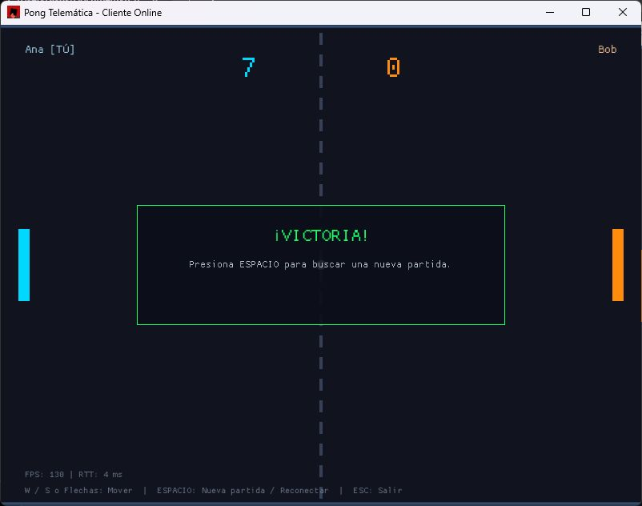
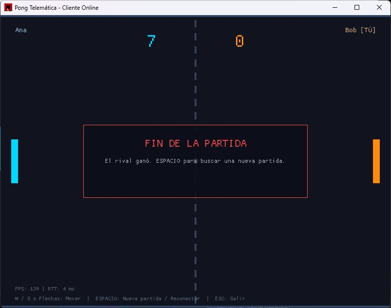

# Fase 6: cliente conectado y sincronización

Implementación: 2026-10-25. La GUI usa el servidor autoritativo a través de
`NetworkBridge`. La demo local se conserva como opción explícita `--demo`.

## Ejecución en este computador

Desde la raíz del repositorio, abrir tres terminales. Rust 1.90.0 se selecciona
automáticamente mediante `rust-toolchain.toml`.

Servidor:

```powershell
cargo run --locked --bin server --no-default-features --target-dir target/codex-validation -- 8080 target/codex-validation/server.log
```

Primer cliente:

```powershell
cargo run --locked --bin client --target-dir target/codex-client-validation -- 127.0.0.1:8080 Ana ana@example.com
```

Segundo cliente:

```powershell
cargo run --locked --bin client --target-dir target/codex-client-validation -- 127.0.0.1:8080 Bob bob@example.com
```

También se puede iniciar sin argumentos y completar el formulario gráfico:

```powershell
cargo run --locked --bin client --target-dir target/codex-client-validation
```

`--help` muestra las opciones y `--demo` selecciona la simulación local. Los
correos anteriores son datos ficticios de prueba; cada jugador puede indicar
su propio perfil.

## Controles y ciclo de conexión

- `W`/`S` o flechas: mover la pala asignada por el servidor.
- `ESPACIO`: buscar otra partida al terminar, o reconectar después de un error.
- `ESC` o cierre nativo de ventana: salir y avisar al servidor.
- El registro y el emparejamiento son automáticos; espacio no reinicia una
  partida en curso ni modifica su marcador.

El formulario acepta servidor, nickname y correo; valida puertos y límites
UTF-8, y permite navegación con TAB, selección y edición de texto. El HUD muestra
FPS, RTT o el estado de conexión. Los controles aparecen en una segunda línea
para evitar que se superpongan con la telemetría.

## Implementación paso a paso

1. **Configuración:** `NetworkConfig` valida datos sin abrir sockets ni resolver
   DNS en el hilo gráfico. El inicio acepta formulario o argumentos.
2. **Trabajador:** `src/client/network.rs` es dueño del socket no bloqueante;
   recibe intenciones por el puente y publica `GameStateSnapshot`.
3. **Registro:** reintenta `HELLO_REQ`, comprueba `HELLO_ACK`, conserva sesión y
   espera `MATCH_START`. Un control duplicado no vuelve a cero el juego.
4. **Entradas:** recuerda la intención actual y la repite cada 50 ms, incluso
   si el usuario mantiene una tecla y la GUI no genera otro evento.
5. **Estado:** usa posiciones, palas y marcadores recibidos del servidor;
   convierte los marcadores `u8` a `u16` y conserva lado/nombres del emparejamiento.
   Las velocidades visuales se estiman de fotos consecutivas, no son físicas
   autoritativas. El temporizador visual del punto parte de la pausa de 800 ms.
6. **RTT:** `PING`/`PONG` usan token `u32` y reloj monotónico. Solo una respuesta
   correlacionada actualiza la medición; el ping no mantiene la pala moviéndose.
7. **Cierre:** `LEAVE` termina la participación en lobby o partida. El hilo de
   simulación resuelve el abandono y la victoria del rival. El cierre de la GUI
   espera el trabajador sin bloquear fotogramas; una resolución DNS lenta del
   sistema no congela indefinidamente la ventana al salir.
8. **Reconexión:** `Ready` abre un endpoint nuevo tras un estado terminal, limpia
   sesión y secuencias y vuelve al registro. No depende de que expire la caché
   anterior del servidor.
9. **Tolerancia UDP:** filtra origen y sesión, descarta datos inválidos y estados
   atrasados, y admite metadata y foto terminal que lleguen después del resultado.
   El servidor conserva y reenvía el marcador final durante cinco segundos.
10. **Puente:** al cerrarse el canal se conserva un `GameOver` o una razón de
    desconexión ya recibidos, para no reemplazarlos por un error genérico.

Se añadieron tres opcodes manteniendo la cabecera y formatos previos de versión
1: `PING` (0x0008), `PONG` (0x0009) y `LEAVE` (0x000A). Los detalles binarios y
las reglas actualizadas están en `docs/protocolo.md`.

## Verificación automatizada

```powershell
cargo fmt --all -- --check
cargo clippy --locked --all-targets --target-dir target/codex-client-validation -- -D warnings
cargo test --locked --target-dir target/codex-client-validation
cargo check --locked --bin server --no-default-features --target-dir target/codex-validation
cargo check --locked --bin client --target-dir target/codex-client-validation
```

Las pruebas incluyen registro con pérdida, estado/control fuera de orden,
validación de sesión, tokens RTT incorrectos, timeout, salida y reconexión,
cuatro trabajadores reales en dos partidas, canal cerrado y partida completa
hasta siete puntos. `tests/protocol_extensions.rs` verifica los mensajes nuevos
y el servidor; `tests/client_network.rs` usa el mismo trabajador que la GUI sin
necesitar GPU.

## Evidencia visual local

Se abrió el formulario, se comprobó su validación y se ejecutaron dos ventanas
conectadas al mismo servidor. Ambas mostraron **7:0**, con lado/nombres correctos,
victoria o derrota según el jugador y RTT de **4 ms** en esa observación local.





## Aceptación entre dos computadores

La implementación está comprobada en localhost. Para acreditar el criterio
formal de dos clientes en equipos físicos distintos falta esta prueba:

1. Ejecutar el servidor en un computador accesible por ambos clientes, con su
   puerto UDP disponible en la red.
2. Usar su dirección real y puerto en el formulario de cada cliente. En este
   escenario `127.0.0.1` apunta a cada equipo por separado y no al servidor remoto.
3. Registrar perfiles distintos, comprobar palas/lados, mantener y soltar teclas,
   jugar hasta siete puntos y comparar marcadores y ganador.
4. Cerrar un cliente y verificar la notificación en el rival; usar ESPACIO para
   volver al emparejamiento. Registrar logs y RTT de esa red.

Este entorno dispone de un único computador: la prueba entre dos equipos y el
despliegue AWS no se declaran realizados. La fase 7 incluye AWS, medición por
Internet y los entregables finales README y Makefile.
